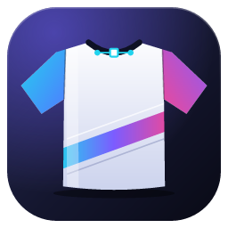
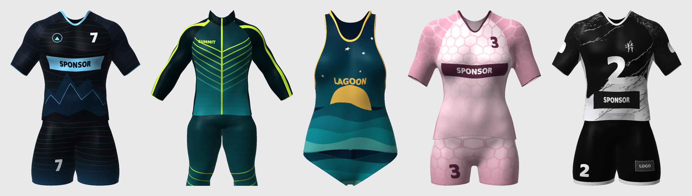
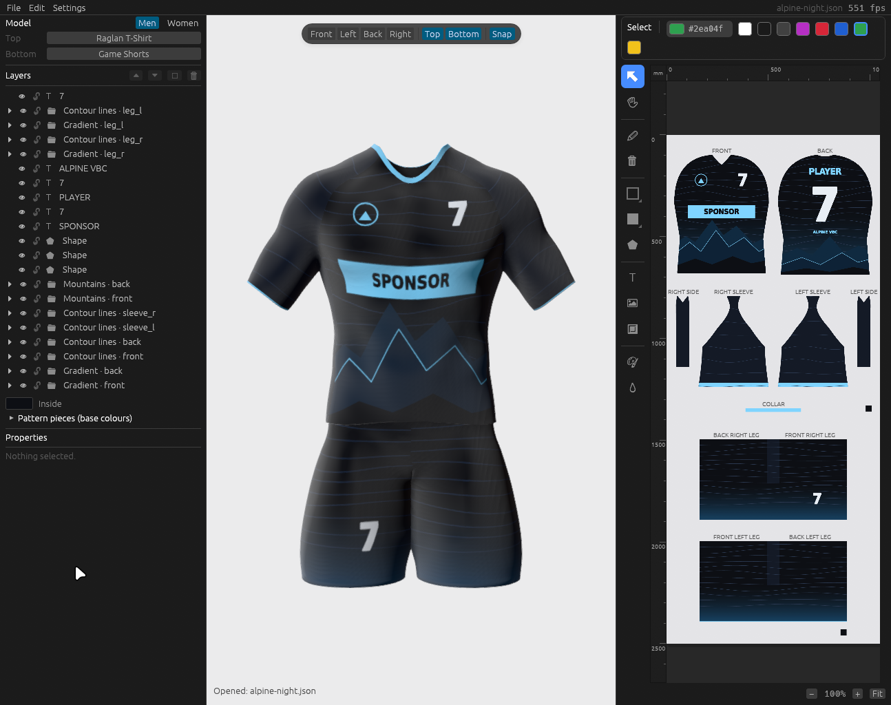
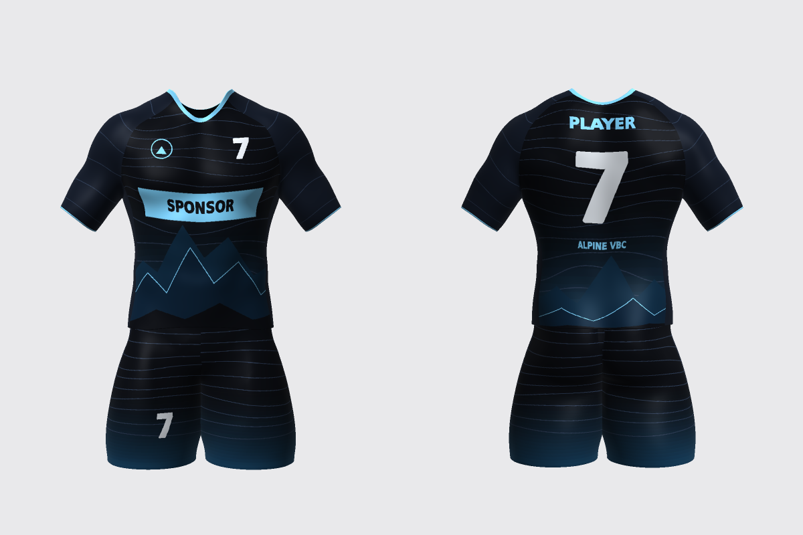
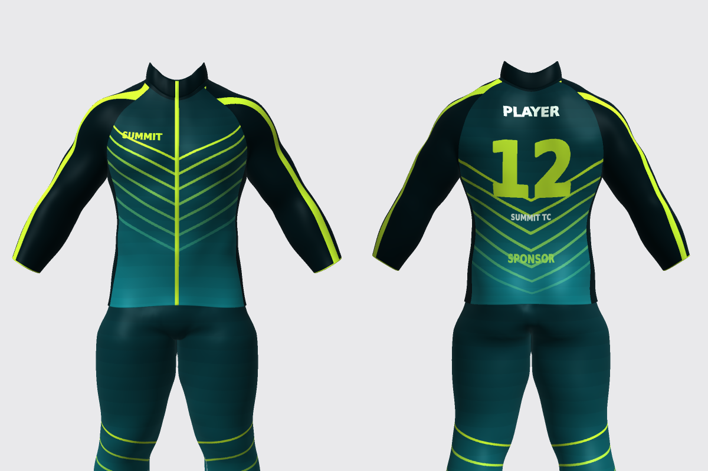
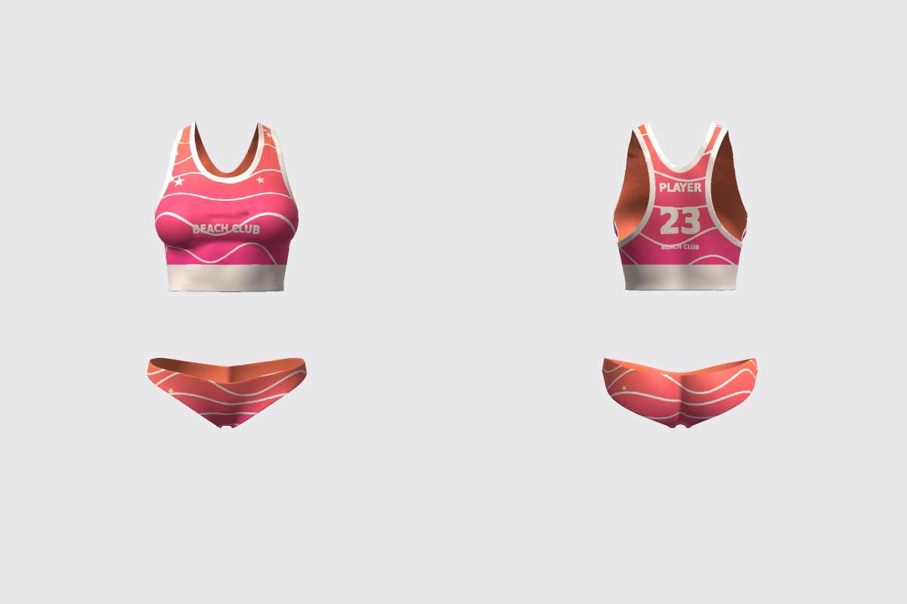
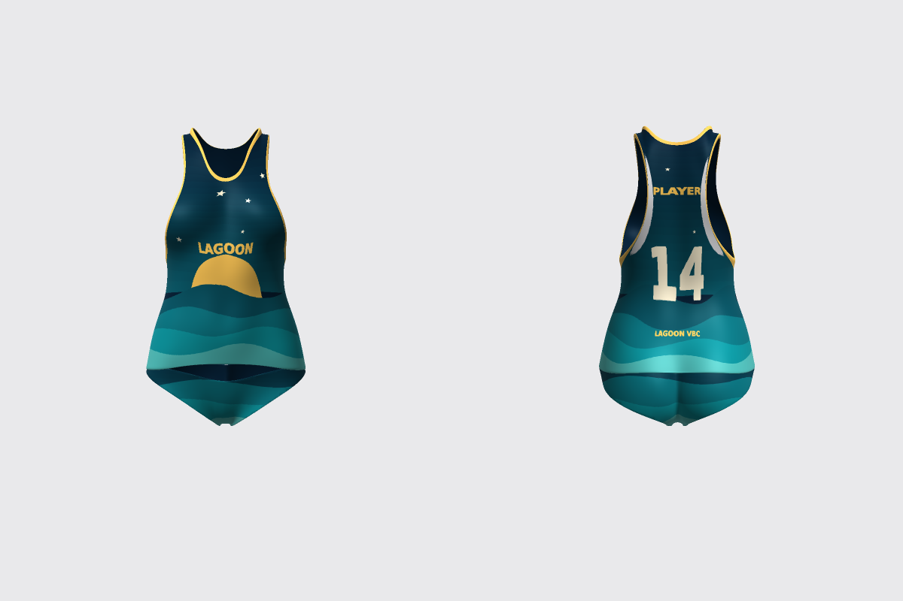
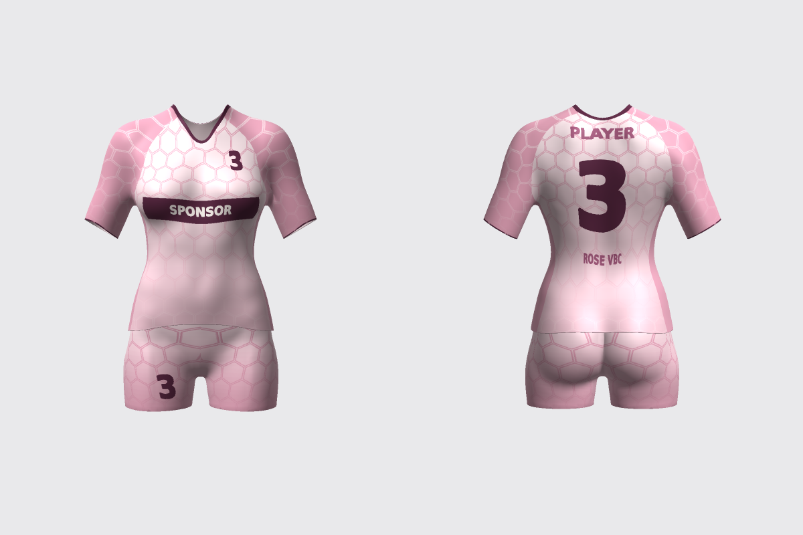
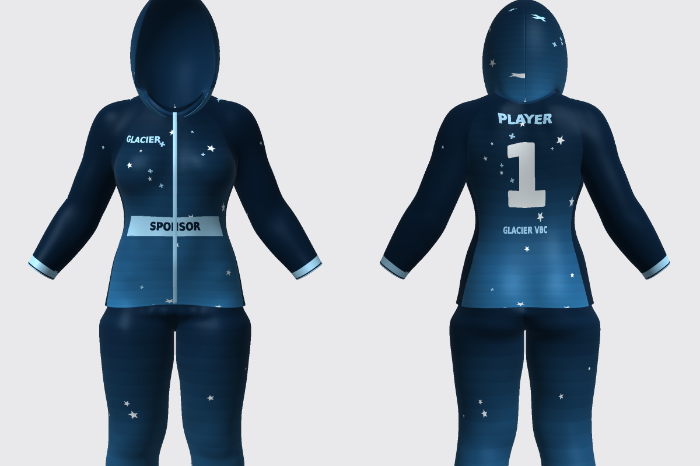
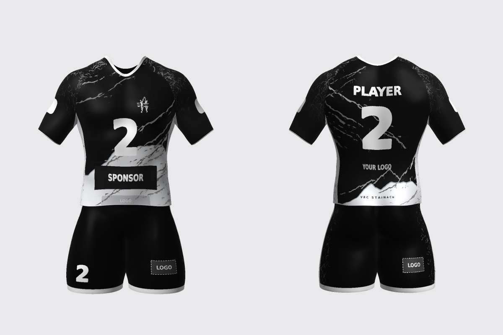

<p align="center">
  
</p>

<h1 align="center">OpenJersey</h1>

<p align="center">
  Design sports kits in 3D and as print-ready templates, by hand or with an AI assistant.
</p>

<p align="center">
  <a href="https://github.com/GodGotzi/openjersey/actions/workflows/ci.yml"></a>
  <a href="LICENSE"></a>
</p>

<p align="center">
  
</p>

OpenJersey is a jersey designer written in Rust. You put a design on a 3D garment and edit it in two places at once: on the model itself, and on the flat **print sheet** that a sublimation printer needs, with every piece of the garment laid out. What you change in one shows in the other.

It also has an [MCP](https://modelcontextprotocol.io) interface, so Claude Code, Codex or any other MCP client can design in your open window: add shapes and lettering, set colours, switch garments, look at renders of its work and fix what it sees. The kits above were made that way.

## Highlights

- **19 garments in 32 variants** for men and women: T-shirts, polo, tank tops, jackets, shorts, pants, tights, a beach set. Every top fits every bottom.
- **A 2D editor** with text, brush, shapes (rounded rectangle, star, arrow, hexagon and more, outlined or filled), polygons, images and SVG, logo placeholders, fill and eyedropper, a proper colour picker, rulers in millimetres, layers and groups.
- **A lit 3D view** with front, left, back and right views, in which you can select and drag objects directly on the garment, with snapping to everything else on the design.
- **Print-ready export**: the sheet as a PNG, logo placeholders left out.
- **An AI-friendly interface**: 34 tools, `batch` calls that undo as one step, renders the assistant can look at. See [Working with AI assistants](docs/ai-assistants.md).
- English and German, with a translation system that makes adding a language a single file.



## Examples

A selection of the designs in [`docs/examples`](docs/examples/README.md), which are files you can open. Six were designed through MCP; the last is one of VBC Stainach's own kits.

<table>
  <tr>
    <td align="center"><br><b>Alpine Night</b><br>layered mountains, contour lines</td>
    <td align="center"><br><b>Summit Teal</b><br>track suit, fading chevrons</td>
  </tr>
  <tr>
    <td align="center"><br><b>Coral Wave</b><br>sports top and slip, waves and stars</td>
    <td align="center"><br><b>Lagoon</b><br>tank top and slip, a sun setting behind the waves</td>
  </tr>
  <tr>
    <td align="center"><br><b>Rose Quartz</b><br>pastel honeycomb</td>
    <td align="center"><br><b>Glacier</b><br>hooded jacket, snow stars</td>
  </tr>
  <tr>
    <td align="center" colspan="2"><br><b>VBC Stainach, contrast kit</b><br>black and white marble lines</td>
  </tr>
</table>

## Quick start

You need a recent stable [Rust](https://rustup.rs) toolchain and a GPU with a Vulkan, Metal or DX12 driver. Only Linux has been tried so far.

```sh
git clone https://github.com/GodGotzi/openjersey
cd openjersey
cargo run --release
```

On Linux, `./install/install-linux.sh` also adds OpenJersey to your app launcher. [Getting started](docs/getting-started.md) has the command line, the environment variables and the Linux packages.

## Use it with an AI assistant

```sh
claude mcp add openjersey -- /path/to/openjersey mcp
```

Then ask for what you want: *"Design a navy and gold jersey for my club, number 7, with a mountain motif on the front, and check how it looks."* The assistant works in your open window; every change is one undo step. For Codex and other clients, and what a session looks like, see [Working with AI assistants](docs/ai-assistants.md). Every tool is in the [MCP tool reference](docs/mcp-tools.md).

## Documentation

| | |
| --- | --- |
| [Getting started](docs/getting-started.md) | Build, run, install, command line, environment variables |
| [User guide](docs/user-guide.md) | The editor, the tools, shortcuts |
| [Working with AI assistants](docs/ai-assistants.md) | MCP setup and how the examples were made |
| [MCP tool reference](docs/mcp-tools.md) | All tools and prompts |
| [Examples](docs/examples/README.md) | The designs and the scripts that built them |
| [Garment library](docs/garments.md) | The garments and how they are built with Blender |
| [Translations](docs/translations.md) | Adding a language |
| [Architecture](docs/architecture.md) | How the code fits together |

## Contributing

```sh
cargo test --release
cargo clippy --release --all-targets
```

Code is formatted with `cargo fmt` (see `rustfmt.toml`). New garments are added with the Blender scripts, with no Rust change; see [blender/GARMENTS.md](blender/GARMENTS.md).

## License and credits

OpenJersey is free software under the [GNU GPL v3](LICENSE) (or later).

The garments are generic cuts of common sports apparel, built by the Blender scripts in `blender/`. Third-party assets: Blender Studio's *Human Base Meshes* (CC0; mannequins used only to fit the garments), Poly Haven's "Studio Small 09" HDRI (CC0) and DejaVu Sans (free license). The 3D view is built on the [Myth](https://crates.io/crates/myth-engine) engine and [egui](https://github.com/emilk/egui).

The two VBC Stainach examples are that club's own designs.
