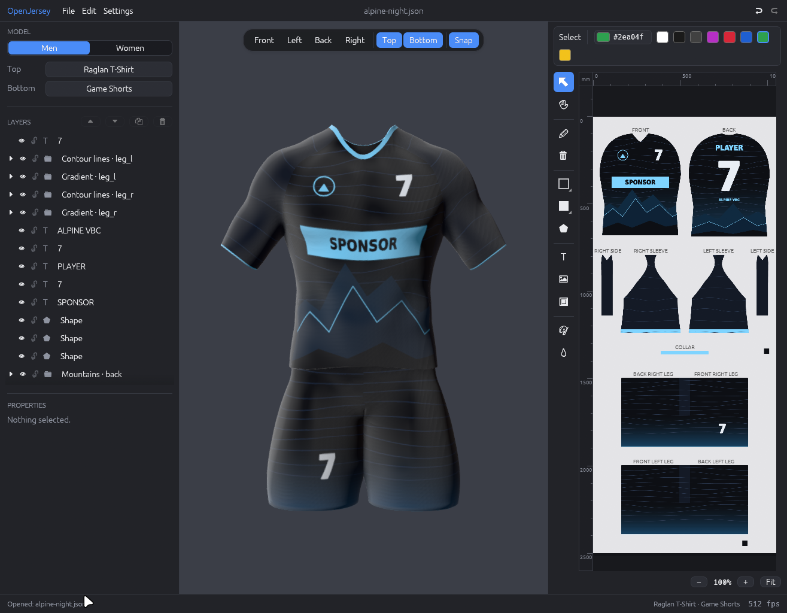

# OpenJersey documentation

| | |
| --- | --- |
| [Getting started](getting-started.md) | Build, run, install, command line and environment variables |
| [User guide](user-guide.md) | The editor: garments, the 3D view, tools, shapes, colours, layers, snapping, files, shortcuts |
| [Working with AI assistants](ai-assistants.md) | Connect Claude Code, Codex or any MCP client; a typical session; how the examples were made |
| [MCP tool reference](mcp-tools.md) | Every tool, its parameters and the prompts (generated from the running server) |
| [Examples](examples/README.md) | The example designs, the scripts that built them, how to rebuild them |
| [Themes](themes.md) | The six colour themes and how they are stored |
| [Garment library](garments.md) | The garments, how they are built with Blender, how to add one |
| [Translations](translations.md) | How texts are stored, how to add a language |
| [Architecture](architecture.md) | How the code is organised and how a change travels through the app |

