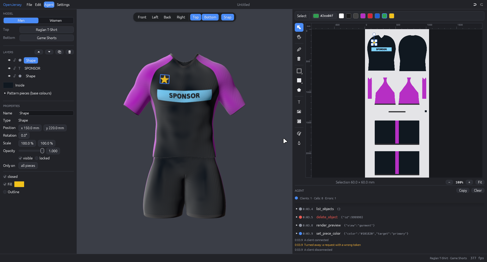

# Working with AI assistants

OpenJersey has an [MCP](https://modelcontextprotocol.io) interface, so an AI assistant can design with the same tools you use: it adds text, shapes and logos, sets colours, switches garments, saves the design and looks at renders of the result. The designs in the [examples](examples/README.md) were made this way.

## Connect a client

`openjersey mcp` is a small bridge that speaks MCP over stdin/stdout and forwards every call to the running app. If the app isn't running, the bridge starts it.

```sh
# Claude Code
claude mcp add openjersey -- /path/to/openjersey mcp
```

```toml
# Codex: ~/.codex/config.toml
[mcp_servers.openjersey]
command = "/path/to/openjersey"
args = ["mcp"]
```

Any other MCP client that can launch a stdio server works the same way. Then ask for something: *"Design a navy and gold jersey for my club, number 7, with a mountain motif on the front."*

What the assistant does happens in your open window. Each change is one undo step, and `Ctrl+Z` takes it back.

## What a session looks like

1. `get_overview` tells the assistant the sheet size, where every piece is, the colours and the garments; `list_garments` lists what it can switch to.
2. It chooses garments and colours: `set_garment`, `set_piece_color`.
3. It adds the design in one or a few [`batch`](mcp-tools.md#batch) calls (several tools, one undo step, optionally all-or-nothing). Positions are millimetres on the sheet, or a garment position (`panel`, `across_mm`, `above_hem_mm`). `clip` keeps an object on certain pieces, which is how a pattern can run off the edge of a panel like a real sublimation print.
4. `render_preview` returns PNGs of the sheet and of the garment from the front and back; with `piece` it zooms into one piece to check details. The assistant looks at them and corrects.
5. `group_objects` tidies what it made into named layers, and `save_design` / `export_print_template` write the files.

The server sends the client short instructions with exactly this workflow, and offers two prompts, `design_jersey` and `review_design`. The full list is in the [tool reference](mcp-tools.md).

## Tips for good results

- Let the assistant look: ask it to render and review before it calls a design finished.
- Pattern work (contour lines, stripes, honeycombs) is many objects. Batch them and group them by purpose so the layers list stays readable.
- Gradients are stacked bands of slightly different colours; a few dozen thin rectangles look smooth.
- Text is never mirrored. On the back the wearer's left is on the left of the sheet.
- Keep logo placeholders where they are unless you ask otherwise; `import_image` can fill one.

## Agent mode

Click **Agent** in the menu bar, before Settings, to open a log at the bottom of the right sidebar. It shows what an assistant does from the outside: when a client connects or disconnects, requests turned away for a wrong token, and every tool call with its arguments, result or error, how long it took and whether the design changed. Click a call for details, **Copy** puts the log on the clipboard and **Clear** empties it. The panel keeps the last 500 events, and the choice is remembered (`agent_mode` in `settings.toml`).



## Security

The app listens on `127.0.0.1` only. The bridge authenticates with a random token from `~/.cache/openjersey/session.json` (readable by your user only). The file tools only write paths ending in `.json` (designs) or `.png` (exports), so an assistant can't overwrite arbitrary files.

## How the examples were made

[`docs/examples/build_examples.py`](examples/build_examples.py) is an MCP client written for this purpose (`mcp_client.py` is the whole protocol layer, 33 lines). For each design it picks the garments and colours and sends the objects in `batch` calls, with helpers for the recurring motifs: gradients, contour lines, mountain ridges, stripes, chevrons, honeycombs and scattered stars. It then groups the objects into layers, saves `docs/examples/<name>.json` and writes the renders to `docs/images/`. [`adapt_club_design.py`](examples/adapt_club_design.py) loads a club's own saved design through MCP and prepares it for publishing.

To keep your own open OpenJersey window out of it, give the script its own session directory; the bridge talks to whichever app owns the session file:

```sh
XDG_CACHE_HOME=/tmp/oj-cache XDG_CONFIG_HOME=/tmp/oj-config python3 docs/examples/build_examples.py
```
