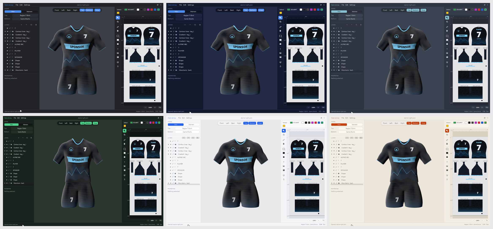

# Themes



OpenJersey comes with six colour themes, and you can add your own. Pick one under **Settings → Theme**; it applies at once and is remembered for the next start.

| Theme | Look |
| --- | --- |
| **Graphite** (default) | Neutral dark grey with a blue accent |
| **Midnight** | Dark navy with a bright blue accent |
| **Nord** | Blue-grey, with the Nord palette's frost-blue accent |
| **Forest** | Deep green with a mint accent |
| **Daylight** | Clean light grey and white with a blue accent |
| **Paper** | Warm cream with an orange-red accent |

A theme changes everything the app draws: the panels, buttons and menus, the selection and the active tool, the 2D editor's canvas and rulers, and the background of the 3D view.

`OJ_THEME=nord openjersey` starts with a theme for one run (the file name without `.toml`). Otherwise the saved choice is used (`theme` in `~/.config/openjersey/settings.toml`), and Graphite if there is none.

## Your own themes

Themes that are not bundled with the app go in the `themes/` folder of your configuration folder. The app creates the folder at its first start, next to `settings.toml`. A file you put there shows up in the Theme submenu, under *Your themes*:

```
~/.config/openjersey/themes/ocean.toml        (or $XDG_CONFIG_HOME/openjersey/themes/)
```

Three ready-made ones to copy, [`ocean`, `dusk` and `rose`](../examples/themes), are in the examples. The format is the one described below; the quickest start is a copy of one of the files in [`themes/`](../themes) with a new `name`. `order` can be left out. Themes are read when the app starts, so restart it after adding or changing a file.

- The file name (without `.toml`) is the theme's id, which `OJ_THEME` takes too.
- A file that can't be used does not break anything: it is listed in the Settings menu in the warning colour with the reason (a colour that isn't `#rrggbb`, a missing key, or a name that a bundled theme already has).
- The Theme submenu shows the folder at its bottom.
- Only the bundled themes are checked for readability. Pick colours with enough contrast between `text` and the backgrounds yourself.

## How themes are stored

Themes are presets, plain files in [`themes/`](../themes). `build.rs` embeds them at compile time, like the translations, and checks that they are valid TOML. Each one is a short file:

```toml
name = "Graphite"
order = 1          # position in the Settings menu
dark = true        # starts from egui's dark or light base

[colors]
window = "#1c1d21"          # windows, menus and popups
panel = "#222328"           # side panels and bars
surface = "#2c2e35"         # buttons, inputs and cards
surface_hover = "#363943"   # a button under the pointer
surface_active = "#40444f"  # a pressed or open button
border = "#383b44"          # outlines and separators
text = "#e9eaee"            # normal text
text_weak = "#8e93a0"       # hints and secondary text
accent = "#4a8cf7"          # the selection and the active tool
accent_text = "#ffffff"     # text on the accent colour
input = "#17181c"           # the inside of text fields
canvas = "#18191d"          # behind the print sheet in the 2D editor
viewport = "#3b3e47"        # the background of the 3D view
ruler = "#1e1f24"           # the rulers of the 2D editor
warn = "#e3a93c"            # warnings
error = "#ea5a52"           # errors

[shape]
rounding = 6       # corner radius of buttons and fields
```

`src/theme.rs` turns this into an egui style (colours, corner radius, spacing and type sizes) and provides the colours to the parts the app paints itself.

## Adding a bundled preset

Copy one of the files in `themes/`, give it a new `name` and `order`, change the colours and rebuild. No code changes are needed. `cargo test` checks that every theme

- parses and has a unique order,
- is readable: text against every background it is drawn on, secondary text, and text on the accent colour all meet minimum contrast ratios,
- is marked `dark` consistently with its colours,
- gives the 3D view exactly the background colour it names. (The engine passes the background through its tone mapping, so the app inverts that; the test checks the result.)
