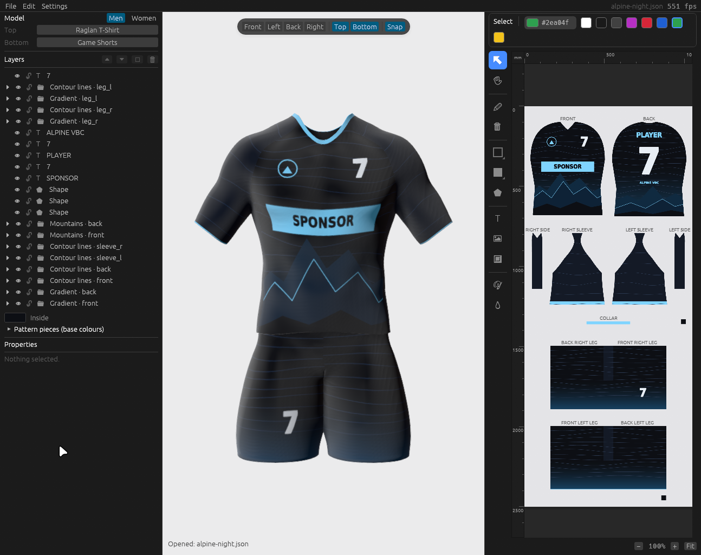

# User guide

The window has a **title bar** on top (the menus, the design's file name, undo and redo), a **status bar** at the bottom (the last message, the garments in use, the frame rate) and, between them, three areas: the **sidebar** on the left (garments, layers, properties), the **3D view** in the middle and the **2D editor** on the right, where the print sheet is drawn. Both views show the same design; you can pick and move objects in either.

## Garments

A design wears one **top** and one **bottom** on one **body** (men or women). The *Model* block at the top of the sidebar names them and switches the body. Click *Top* or *Bottom* to open the **garment browser**: a searchable grid where every card shows the outline of that garment's print template. Click a card to put the design on it.

- Switching garments keeps the design where it is on the body. Objects on pieces the new garment doesn't have (sleeves on a tank top) are hidden and come back when you switch back.
- Top and bottom are saved with the design.
- See [Garment library](garments.md) for what is available.

## The 3D view

Drag to orbit, scroll to zoom. Click an object on the model to select it, drag it to move it. The floating toolbar at the top of the view has:

- **Front / Left / Back / Right**: move the camera to that side.
- **Top / Bottom**: show or hide a garment. A hidden garment is also left off the print sheet (a warm-up shirt without shorts, for instance).
- **Snap**: snapping while you drag (see below).

The toolbar hides itself when the view is too narrow for it.

## The 2D editor

The sheet shows every piece of the top and the bottom laid out like a sublimation print sheet. Scroll to zoom, drag with the middle or right button (or hold Space, or use the Hand tool) to pan. Rulers show millimetres from the sheet's corner; the status bar shows the cursor position, the size of the selection and zoom controls.

### Tools

Hover a tool for its name, what it does and its shortcut.

| Tool | Key | What it does |
| --- | --- | --- |
| Select | V | Select, move, scale (corner handles), rotate (round handle). Shift adds to the selection; while scaling it switches between proportional and free scaling, while rotating it snaps to 15° |
| Hand | H | Pan |
| Brush | B | Freehand strokes in the paint colour; the size is in the options bar |
| Eraser | E | Delete brush strokes by dragging over them |
| Outline shape | O | Drag out an unfilled shape |
| Filled shape | S | Drag out a filled shape, optionally with an outline |
| Polygon | P | Click to add points; double-click or Enter closes it |
| Text | T | Click to place the text from the options bar |
| Image / SVG | I | Import a PNG, JPG or SVG, then click to place it |
| Logo placeholder | L | Drag out a box that marks where a logo goes; it is left out of the print file |
| Fill | F | Click a piece or an object to colour it |
| Eyedropper | Y | Take a colour from the sheet |

**Shape buttons.** The outline and filled shape buttons each show the shape currently chosen for them. Click one to open a flyout beside it and choose: rectangle, ellipse, rounded rectangle, triangle, diamond, pentagon, hexagon, star, arrow, chevron, cross and (for outlines) line. Then drag the shape out. A filled shape can get an outline too: switch *Outline* on in the options bar.

### Colours

The colour button in the options bar shows the paint colour and its hex code. It opens a picker with a colour square and hue bar, a hex field and R/G/B values, **Pick from sheet** (the eyedropper), the **design's own colours**, **recent colours** and a palette. The row of swatches next to it is a shortcut to eight common colours.

The base colours of the garment pieces live under *Pattern pieces* in the sidebar: a primary, an accent and a trim colour, plus per-piece overrides.

## Layers and properties

The *Layers* list shows every object: text, graphics, shapes, lines, watermark patterns, logo placeholders and groups. You can hide or lock them, rename them (double-click), reorder them or drop them into groups by dragging, and use the context menu (duplicate, delete, group, ungroup, restack, centre on piece, mirror front ↔ back). The *Properties* panel edits the selected object: position in millimetres, rotation, scale, opacity, which pieces it is shown on ("only on"), and settings for its kind (text, size, colours, tint; *Insert logo…* turns a placeholder into a graphic).

A click selects the outermost group; once a member of a group is selected, further clicks pick its siblings, so group members can be moved one by one with the mouse. Ctrl+click or a double-click selects a member directly.

## Snapping

With **Snap** on, a dragged object's edges and centre snap to the centre lines of the front and back, to piece centres and to the edges and centres of every other object, images and logos included, in both views.

## Files and export

| Menu | |
| --- | --- |
| File → New / Open / Save / Save as | Designs are `.json` files with their graphics embedded |
| File → Template | Start from a ready-made design |
| File → Export print template | The sheet as a PNG for the printer; logo placeholders are left out |
| Settings | Opens a small window: language (English, Deutsch), the colour theme from a dropdown (the bundled ones and your own, see [Themes](themes.md)) and VSync. The choices are remembered |

Older save files open too; they are moved onto the current sheet layout.

## Keyboard shortcuts

| Keys | |
| --- | --- |
| Ctrl+Z, Ctrl+Y (or Ctrl+Shift+Z) | Undo, redo (also the arrow buttons at the right of the title bar) |
| Ctrl+C, Ctrl+V | Copy, paste |
| Ctrl+D | Duplicate |
| Ctrl+G, Ctrl+Shift+G | Group, ungroup |
| Ctrl+A | Select all |
| Ctrl+O, Ctrl+S | Open, save |
| Delete, Backspace | Delete the selection |
| Arrow keys | Nudge by 1 mm (Shift: 10 mm) while the pointer is over the sheet |
| Escape | Clear the selection / cancel a polygon |
| V H B E O S P T I L F Y | The tools |
